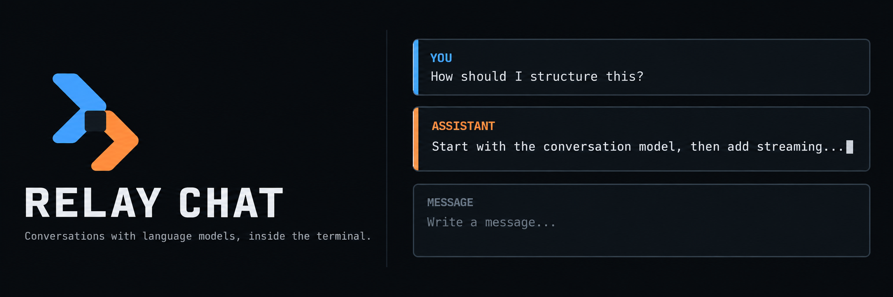

<p align="center">
  
</p>

Relay Chat is a reusable terminal interface for conversations with language models. It provides multiline input, streamed replies, readable Markdown, conversation history, save and export commands, and the controls needed to revise a turn without choosing a model provider for the application using it.

## Try the demo

```sh
npm install
npm run demo
```

The demo streams deterministic replies without downloading a model or contacting a service. Write a message and press `Enter`. `Ctrl+J` adds a line, `Escape` cancels a reply, `Ctrl+G` opens the complete keyboard reference, and `Ctrl+C` exits while idle.

For a demonstration that prints one reply and exits:

```sh
npm run demo:plain
```

## Connect a model command

Relay Chat can launch a local command and exchange a conversation through JSON Lines:

```sh
relay-chat -- node my-model-adapter.mjs
```

The command receives one request on standard input. It streams text, model metadata, token usage, completion, or a deliberate error on standard output. Diagnostic output belongs on standard error.

```json
{"type":"delta","text":"The first part of the reply"}
{"type":"usage","usage":{"inputTokens":18,"outputTokens":7}}
{"type":"done"}
```

The included adapter demonstrates the complete exchange:

```sh
npm run demo:command
```

See [the command protocol](./docs/command-protocol.md) for the request and response shapes.

## Conversation controls

| Key                    | Action                                     |
| ---------------------- | ------------------------------------------ |
| `Enter`                | Send the current draft                     |
| `Ctrl+J`               | Insert a newline                           |
| `↑`, `↓`               | Browse submitted drafts                    |
| `Page Up`, `Page Down` | Move through the conversation              |
| `Escape`               | Cancel a reply or leave edit mode          |
| `Ctrl+E`               | Edit and resend the latest user message    |
| `Ctrl+R`               | Regenerate the latest assistant reply      |
| `Ctrl+Y`               | Retry a failed or cancelled reply          |
| `Ctrl+S`               | Save the conversation                      |
| `Ctrl+N`               | Start a new conversation                   |
| `Ctrl+G`               | Toggle help                                |
| `Ctrl+C`               | Cancel an active reply, or quit while idle |

Slash commands manage titles, system prompts, model labels, themes, files, exports, retry, and regeneration. The complete list is in [the slash-command reference](./docs/slash-commands.md).

## Use the package

Applications can render the complete interface or assemble their own from the exported store, session, transport, and message components.

```tsx
import {render} from 'ink';
import {ChatApp, ChatSession, ChatStore, EchoTransport} from '@relay-cli/chat';

const store = new ChatStore();
const transport = new EchoTransport();
const session = new ChatSession(store, transport);

const app = render(
  <ChatApp
    store={store}
    session={session}
    transportName={transport.name}
    onQuit={() => app.unmount()}
  />,
);
```

Implement `ChatTransport` to connect model code inside the same process. Use `CommandTransport` when the model runs behind another executable.

## Conversation files

`/save` writes versioned JSON with an atomic replacement. `/load` restores that record, and `/export` creates a Markdown transcript. The default `conversations/` directory is ignored by Git because prompts and replies may contain private information.

## Documentation

- [Package API](./docs/api.md)
- [Architecture](./docs/architecture.md)
- [Model command protocol](./docs/command-protocol.md)
- [Conversation files](./docs/conversation-files.md)
- [Keyboard reference](./docs/keyboard.md)
- [Slash commands](./docs/slash-commands.md)

## Scope

This release covers conversations. Agent execution, tool activity, and approval interfaces will be designed as a separate layer after the chat behavior is established.

## Development

```sh
npm install
npm run check
```

`npm run check` verifies formatting, linting, strict types, tests, and the distributable package.

## License

MIT
